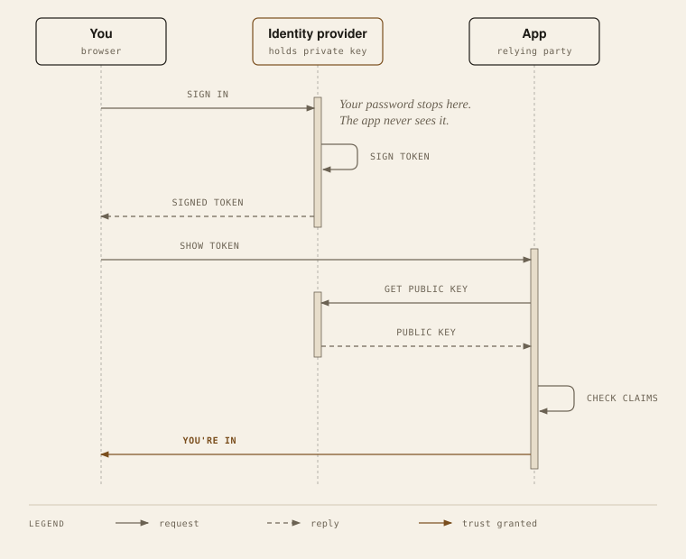
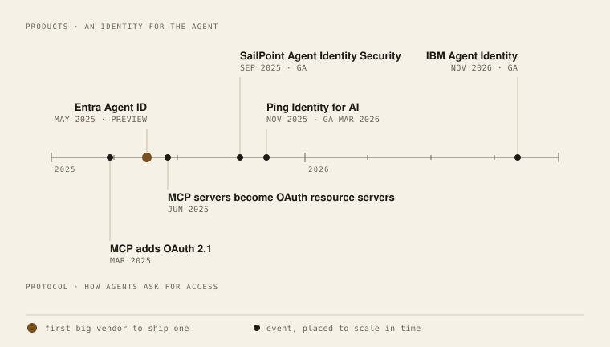

# 001 · Who vouches for you?

> *Quis custodiet ipsos custodes?* Who will guard the guards themselves?
>
> Juvenal, *Satires* VI

## The question

You open a work app in the morning and it lets you in without asking for a
password. Something already told it who you are.

Who is that something, and why does the app believe it?

## The lesson

### A passport office for the internet

An **identity provider (IdP)** checks who you are once and then **vouches for
you** to other apps. The apps are called *service providers* or *relying parties*,
because they rely on the IdP's word.

A border crossing works the same way. The guard has never met you. They trust the
passport because:

1. it carries the **seal** of an issuer they trust,
2. it hasn't **expired**, and
3. it is meant for **this** kind of border.

A web login works the same way. The "passport" is a signed token, usually a
[JWT](https://www.rfc-editor.org/rfc/rfc7519) in
[OpenID Connect](https://openid.net/specs/openid-connect-core-1_0.html) or an XML
assertion in SAML 2.0.

<figure class="diagram">
  
  <figcaption>Your password stops at the identity provider. The app checks only the signature and the claims. With an AI agent in the loop, the token names two parties: <code>sub</code> (you) and <code>act</code> (the agent).</figcaption>
</figure>

The app checks four things:

| Claim | Question it answers |
| ----- | ------------------- |
| `iss` | Who signed this? Is it an issuer I trust? |
| `sub` | Who is this about? |
| `aud` | Was it meant for **me**, or for some other app? |
| `exp` | Is it still valid? |

The IdP signs the token with a **private key**. Apps check it with the matching
**public key**, which the IdP publishes (a *JWKS*). The app never sees a password.

### Four verbs of identity

| Verb | Question | Typical standard |
| ---- | -------- | ---------------- |
| **Authenticate** | Are you really Alice? | passwords, passkeys, MFA |
| **Federate** | Can I vouch for Alice to other apps? | SAML 2.0, OpenID Connect |
| **Provision** | Does Alice have an account there before she arrives? Is it gone after she leaves? | [SCIM](https://www.rfc-editor.org/rfc/rfc7644) |
| **Govern** | *Should* Alice still have that access? Who approved it? | access reviews, policies |

### Four vendors, not four of the same thing

**TODO (verify):** ownership and category from each vendor's own "about" page.

| Vendor | Mostly does | Owner (Nov 2026) |
| ------ | ----------- | ---------------- |
| Ping Identity | access management: SSO, MFA, federation, for staff and customers | Thoma Bravo (private); merged with ForgeRock in 2023 |
| OneLogin | workforce SSO and access management | One Identity (Quest) since 2021 |
| IBM Verify | staff and customer identity and access management | IBM; renamed from "IBM Security Verify" in 2025 |
| SailPoint | **identity governance** (IGA) | public (Nasdaq: SAIL) since Feb 2025; Thoma Bravo keeps majority control |

> [!IMPORTANT]
> **The twist:** three of the four are IdPs. SailPoint mostly isn't one. It doesn't
> log you in; it decides **who should have accounts at all** and keeps asking
> whether they still should. An IdP answers *"is this Alice?"*. Governance answers
> *"should Alice still be able to get in?"*

## The demo

A whole IdP, a token and an app, in one HTML file. No server-side code, no accounts.
Everything runs in your browser.

<figure class="demo">
  <iframe src="demo/" title="Demo: an identity provider, a token and an app" loading="lazy"></iframe>
  <figcaption><a href="demo/">Open the demo full screen</a>, or run it locally:
  <code>cd demo &amp;&amp; python3 -m http.server 8000</code></figcaption>
</figure>

What to try:

1. Sign in as `alice` / `wonderland` and verify the token. Every check passes.
2. **Rename sub to mallory.** The payload is just base64, so anyone can edit it.
   The signature no longer matches.
3. **Strip the signature (alg: none).** This is a classic attack. A careful app
   refuses tokens that claim to need no signature.
4. **Re-sign with my own key.** The signature is valid, but it was made with the
   wrong key. Trust comes from *whose* key signed the token.
5. Issue a token for `payroll-app`, then verify it in notes-app. It is valid, but
   meant for someone else.
6. Move the app's clock 10 minutes ahead. The token is valid, but expired.
7. Tick **"An AI agent acts on my behalf"**. The token now carries two names: `sub`
   (Alice) and `act` (the agent). That leads into the next section.

## Under AI

### Now (facts, with sources)

**TODO (read and link each primary source):**

- **Agents are getting their own identities.** Four big vendors shipped this within
  about 18 months, while the protocol agents use to ask for access gained OAuth:

<figure class="diagram">
  
  <figcaption>Agent identity, placed to scale in time. Dates from each vendor's announcement; see Sources.</figcaption>
</figure>

- **"On behalf of" is the new shape of a login.** OAuth Token Exchange
  ([RFC 8693](https://www.rfc-editor.org/rfc/rfc8693)) already defines an `act`
  (actor) claim. An individual IETF draft,
  [draft-oauth-ai-agents-on-behalf-of-user](https://datatracker.ietf.org/doc/draft-oauth-ai-agents-on-behalf-of-user/),
  proposes how users consent to an agent acting for them. It is a draft, not a
  standard.
- **The Model Context Protocol (MCP) added authorization quickly.** The 2025-03-26
  revision added OAuth 2.1. The 2025-06-18 revision made MCP servers OAuth resource
  servers and required [resource indicators (RFC 8707)](https://www.rfc-editor.org/rfc/rfc8707).
- **OneLogin** has an AI risk engine (Vigilance AI, since 2019) and an
  [MCP server for admin tasks](https://www.onelogin.com/blog/accelerate-identity-administration-by-leveraging-ai-llms).
  I couldn't find a named agent-identity product.
- **Standards bodies are slower, and that is deliberate.** The OpenID Foundation
  started a [community group](https://openid.net/cg/artificial-intelligence-identity-management-community-group/)
  on AI identity rather than a working group that writes specifications.
- **Vendors disagree on how many machine identities there are per human.** CyberArk,
  which sells machine-identity security, says 82:1. KuppingerCole, an analyst firm,
  says 25 to 50:1. Nobody counts these the same way, so treat both as rough estimates.

### Next (my opinion)

- **"Who are you?" becomes "who sent you, and who answers for you?"** Tokens will
  routinely carry two identities: the agent that acts and the human who is
  accountable.
- **Login and governance merge.** Agents are created and destroyed in minutes.
  Quarterly access reviews can't keep up, so the IdP itself will need an owner
  field, a kill switch and an audit trail.
- **Vendors first, standards later.** Expect a few years of vendor-specific "agent
  IDs" before an OAuth or OpenID profile settles them.
- Juvenal's question returns: when an agent vouches for another agent, **who
  vouches for the voucher?**

## Sources

- JWT: [RFC 7519](https://www.rfc-editor.org/rfc/rfc7519)
- OpenID Connect Core 1.0: <https://openid.net/specs/openid-connect-core-1_0.html>
- SCIM protocol: [RFC 7644](https://www.rfc-editor.org/rfc/rfc7644)
- OAuth Token Exchange: [RFC 8693](https://www.rfc-editor.org/rfc/rfc8693)
- Resource Indicators: [RFC 8707](https://www.rfc-editor.org/rfc/rfc8707)
- MCP authorization (2025-06-18): <https://modelcontextprotocol.io/specification/2025-06-18/basic/authorization>
- TODO: Ping Identity press release, 2025-11-06 (press.pingidentity.com)
- TODO: Ping Identity press release, 2026-03-24 (press.pingidentity.com)
- TODO: SailPoint press release, 2025-09-30 (sailpoint.com/press-releases)
- TODO: IBM announcement, Agent Identity GA, 2026-11-03 (ibm.com/new/announcements)
- TODO: Microsoft Entra Agent ID announcement, 2025-05-19 (techcommunity.microsoft.com)
- TODO: CyberArk 2025 State of Machine Identity Security Report
- TODO: KuppingerCole 2026 Leadership Compass, Non-Human Identity Management

**Art:** see [art/CREDIT.md](art/CREDIT.md).
